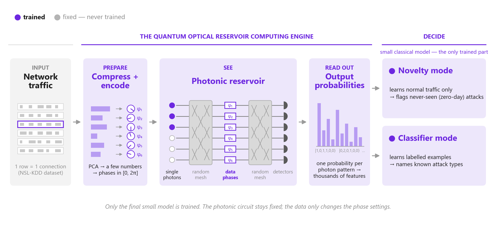

# Zero-day network attack detection with a Quantum Optical Reservoir Computer (QORC)

A beginner-friendly notebook that uses a simulated **photonic quantum reservoir** (Quandela [Perceval](https://perceval.quandela.net/) + [MerLin](https://github.com/merlinquantum/merlin)) to detect network attacks in the NSL-KDD dataset. That includes attack families the models never saw during training.



## What the notebook does

1. **Data:** NSL-KDD connections are grouped into families (normal, DoS, probe, R2L, U2R). Models train on normal + DoS only. Probe, R2L (the main "zero-day" family) and U2R appear only in the test set.
2. **Reservoir:** categorical features are one-hot encoded and numeric features standardised. PCA then reduces each record to `N_MODES` values, which become phases inside a fixed, random linear-optical interferometer. `N_PHOTONS` photons enter the circuit, and the exact probabilities of the output Fock states (photon-occupation patterns; there are `C(N_MODES + N_PHOTONS − 1, N_PHOTONS)` of them) form the feature vector. MerLin computes them on the GPU, and a few records are checked against Perceval's SLOS simulator.
3. **Readouts** (only these are trained):
   - *Quantum classifier*: MLP classifier on reservoir features, trained on labelled normal + DoS.
   - *Quantum anomaly detector*: MLP autoencoder on reservoir features, trained on normal traffic only.
   - *Classical anomaly detector*: the same autoencoder applied directly to the PCA values, with no quantum part. This is the control.
4. **Evaluation:** accuracy, ROC-AUC, per-family recall (R2L recall = zero-day detection) and the normal false-positive rate. Each run is saved to `results/qorc_p{photons}_m{modes}_s{seed}.json`.
5. **Photons × modes comparison:** loads every saved run and compares the configurations, ordered by photons and then modes, as mean ± std over seeds.

## Setup

```bash
python -m pip install -r requirements.txt
```

Keep `NSL_KDD_labeled.csv` in this folder. The Quandela package is installed as `perceval-quandela` but imported as `perceval`. If `perceval.simulators` is missing, you have the unrelated `perceval` package installed. Fix it with `pip uninstall -y perceval` and then reinstall the requirements. A CUDA GPU is used when available but is not required.

## Running

Open `qorc_nsl_kdd.ipynb` and run all cells. The configuration is at the top of the setup cell:

| Setting | Default | Meaning |
|---|---|---|
| `N_MODES` | 24 | optical modes = number of PCA inputs |
| `N_PHOTONS` | 3 | photons injected into the first modes |
| `SEED` | 42 | seed for the data split, the random interferometer and the readouts |
| `BATCH_SIZE` | 1024 | GPU batch size for the reservoir (lower it if GPU memory runs out) |
| `RESULTS_DIR` | `results` | where the JSON result files are written |

Every run writes its metrics to `results/qorc_p{N_PHOTONS}_m{N_MODES}_s{SEED}.json` (accuracy, balanced accuracy, F1, ROC-AUC, normal FPR and per-family recall for each model, plus the configuration and timings). Section 5 loads all JSON files in `results/` and compares them. To add a configuration, change `N_PHOTONS`, `N_MODES` or `SEED`, then run all cells again.

The `results/` folder already holds runs for 3/4 photons × 20/24 modes × seeds 42, 43, 44, so Section 5 works without re-running every configuration.

Runtime on an RTX 2070 laptop: about 1–2 min per 3-photon run and about 6 min per 4-photon run. Most of that time is spent training the sklearn autoencoder on the large reservoir vectors. The 4-photon, 24-mode reservoir has 17,550 Fock states (features).

## Results: photons × modes

Mean ± std over seeds 42, 43, 44 (12 runs in `results/`).

| Photons | Modes | Fock states (reservoir features) | Model | Accuracy | ROC-AUC | R2L recall | Normal FPR |
|---|---|---|---|---|---|---|---|
| 3 | 20 | 1,540 | Quantum classifier | 0.651 ± 0.006 | 0.631 ± 0.049 | 0.009 ± 0.006 | 0.007 ± 0.002 |
| 3 | 20 | 1,540 | Quantum anomaly detector | 0.854 ± 0.016 | 0.962 ± 0.001 | 0.332 ± 0.132 | 0.051 ± 0.012 |
| 3 | 20 | 1,540 | Classical anomaly detector | 0.847 ± 0.021 | 0.947 ± 0.008 | 0.468 ± 0.019 | 0.058 ± 0.013 |
| 3 | 24 | 2,600 | Quantum classifier | 0.664 ± 0.003 | 0.583 ± 0.055 | 0.028 ± 0.036 | 0.005 ± 0.002 |
| 3 | 24 | 2,600 | Quantum anomaly detector | 0.849 ± 0.012 | 0.956 ± 0.004 | 0.313 ± 0.088 | 0.052 ± 0.010 |
| 3 | 24 | 2,600 | Classical anomaly detector | 0.816 ± 0.005 | 0.941 ± 0.013 | 0.381 ± 0.157 | 0.060 ± 0.016 |
| 4 | 20 | 8,855 | Quantum classifier | 0.647 ± 0.008 | 0.643 ± 0.046 | 0.017 ± 0.015 | 0.004 ± 0.002 |
| 4 | 20 | 8,855 | Quantum anomaly detector | 0.863 ± 0.008 | 0.962 ± 0.003 | 0.375 ± 0.085 | 0.052 ± 0.007 |
| 4 | 20 | 8,855 | Classical anomaly detector | 0.847 ± 0.021 | 0.947 ± 0.008 | 0.468 ± 0.019 | 0.058 ± 0.013 |
| 4 | 24 | 17,550 | Quantum classifier | 0.646 ± 0.005 | 0.551 ± 0.046 | 0.004 ± 0.006 | 0.005 ± 0.003 |
| 4 | 24 | 17,550 | Quantum anomaly detector | 0.857 ± 0.008 | 0.958 ± 0.003 | 0.349 ± 0.071 | 0.052 ± 0.010 |
| 4 | 24 | 17,550 | Classical anomaly detector | 0.816 ± 0.005 | 0.941 ± 0.013 | 0.381 ± 0.157 | 0.060 ± 0.016 |


**What the numbers say**

- **Photons and modes barely matter.** For the quantum anomaly detector, accuracy stays between 0.85 and 0.86 and ROC-AUC between 0.956 and 0.962 across all four configurations. A 10× larger reservoir (1,540 → 17,550 Fock states) brings no clear gain beyond seed noise. 4 photons with 20 modes is marginally the best (accuracy 0.863, R2L recall 0.375).
- **The quantum anomaly detector edges out the classical one** on accuracy and ROC-AUC in every configuration (+0.01 to +0.04). It catches fewer R2L zero-day attacks, though (0.31–0.38 vs 0.38–0.47) at a similar false-alarm rate (about 5–6%).
- **The supervised quantum classifier fails on unseen families.** It catches DoS but almost no R2L (≤ 0.03 recall), and its ROC-AUC is only 0.55–0.64. That is the expected behaviour of a model that only learned "normal vs DoS".
- 24 PCA modes perform worse than 20 for the classical detector (0.816 vs 0.847 accuracy), so the extra PCA components add noise more than information on this split.

### How fair is the comparison?

- For a given seed, every configuration uses the **same train/test split**, preprocessing, readout architecture and cutoff rule (95th percentile of held-out normal reconstruction error).
- `N_MODES` also sets the number of PCA inputs, so 24 modes means more input information *and* a larger circuit. The classical anomaly detector depends only on the modes and seed, which separates the "more PCA components" effect from the circuit effect. Its numbers are identical for 3 and 4 photons by construction.
- The reservoir size grows from 1,540 to 17,550 Fock states (features) across the four configurations. The readout layer widths are capped (autoencoder 128-32-128, classifier 64), so the larger reservoirs do not also get larger readouts.
- Three seeds give rough error bars only. Treat differences smaller than about one standard deviation as noise.

## Limitations

The circuit is simulated without losses, noise or finite-shot sampling, and its interferometers are random rather than trained. Results on this controlled NSL-KDD split do not demonstrate a quantum advantage. A stronger claim would need classical nonlinear feature maps of the same size as baselines, more seeds and real-device noise.

## Files

| Path | Contents |
|---|---|
| `qorc_nsl_kdd.ipynb` | the tutorial notebook |
| `results/` | one JSON of metrics per run |
| `figures/` | pipeline diagrams, the comparison plot, and the script that draws the diagrams |
| `NSL_KDD_labeled.csv` | the dataset |
| `requirements.txt` | Python dependencies |
